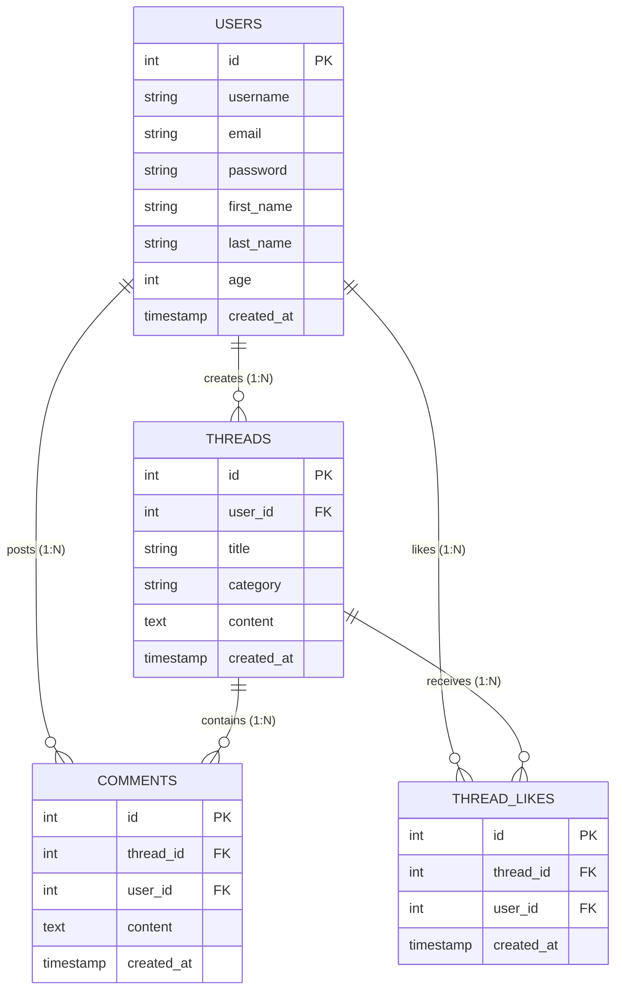

<div align="center">

# 💬 ForumHub
### *A Lightweight, Community-Driven Forum & Discussion Platform*

[](https://www.php.net/)
[](https://www.mysql.com/)
[](https://developer.mozilla.org/en-US/docs/Web/JavaScript)
[](https://www.w3.org/Style/CSS/)
[]()

<br>

<p align="center">
  <b>ForumHub</b> is an interactive web-based community forum built with <b>PHP</b> and <b>MySQL</b>. Designed to deliver clean discussions across multiple interest domains (Programming, Gaming, Education, Careers, Tech & Science), it features secure authentication, categorized threads, interactive comments, thread reactions, and moderation tools.
</p>

[Explore Features](#-key-features) •
[UI Showcase](#-ui-showcase) •
[Database Architecture](#-database--system-design) •
[Getting Started](#-getting-started) •
[The Team](#-project-team--contributors)

---

</div>

<br>

## 📸 UI Showcase

<div align="center">

### 🏠 Community Feed & Thread Explorer
*Browse trending topics, filter by category, and search discussions in real-time.*


<br>

### 🔐 Authentication (Soft Neumorphic Interface)
| User Login | User Registration |
|:---:|:---:|
|  |  |

<br>

### 💬 Discussion & Moderation Flow
| Dynamic Comment Thread | Edit Discussion Thread |
|:---:|:---:|
|  |  |

| Inline Comment Editing | About Community Page |
|:---:|:---:|
|  |  |

</div>

---

## ✨ Key Features

- 👤 **Secure Authentication & Sessions:** User sign up, password hashing via PHP `password_hash()`, validated sign-in sessions, and logout flows.
- 📂 **Categorized Discussions:** Discover and organize threads across specialized tags:
  - `Programming` • `Gaming` • `Education` • `Careers` • `Technology` • `Science`
- 🔍 **Live Search & Discovery:** Quickly find relevant topics and questions by keyword search.
- 📝 **Full Thread Lifecycle:**
  - Create rich discussion threads.
  - Author edit and update capabilities.
  - Safe deletion handling.
- 💬 **Interactive Commenting:** Nested replies to discussions, user attribution, and comment editing/deletion.
- ❤️ **Thread Reactions:** Real-time like and unlike tracking with duplicate prevention per user.
- 📊 **Community Insights:** Live sidebar metrics tracking active member counts, total discussions, and replies.

---

## 🏛 Database & System Design

ForumHub follows a classic **3-Tier Web Architecture**:
- **Presentation Layer:** Semantic HTML5, Neumorphic-inspired CSS, responsive DOM interaction with JavaScript.
- **Application Logic:** Native PHP scripts handling authentication, form validation, and query dispatching.
- **Data Persistence:** Relational MySQL database adhering to normalization rules.

### Entity Relationship Overview



---

## 🗂 Project Structure

```text
ForumHub/
├── assets/                 # UI screenshots and project media
│   ├── About Us - page.png
│   ├── Comment Editing.png
│   ├── Comment Section.png
│   ├── Login Page.png
│   ├── Search Bar.png
│   ├── Signup page.png
│   └── Thread Editing.png
├── css/                    # Modular stylesheets
│   ├── comment_edite.css
│   ├── edit_thread.css
│   ├── index.css
│   └── thread.css
├── login_signup/           # Auth subsystem
│   ├── db.php
│   ├── login.php
│   ├── login_signup.css
│   ├── logout.php
│   ├── script.js
│   └── signup.php
├── php/                    # Backend API scripts & DB migrations
│   ├── create_comment.php
│   ├── create_thread.php
│   ├── db.php
│   ├── db.sql              # Database schema dump
│   ├── delete_comment.php
│   ├── delete_thread.php
│   ├── like_thread.php
│   └── unlike_thread.php
├── About_us.php            # Community About page
├── category.php            # Category-based thread listing
├── edit_comment.php        # Comment update interface
├── edit_thread.php         # Thread update interface
├── footer.php              # Global footer component
├── index.php               # Homepage & discussion feed
├── Right_Sidebar.php       # Community statistics sidebar
├── search.php              # Discussion search handler
├── thread.php              # Thread view & replies page
└── README.md
```

---

## 🚀 Getting Started

### Prerequisites
- [XAMPP](https://www.apachefriends.org/) / [WampServer](https://www.wampserver.com/en/) / [LAMP stack](https://ubuntu.com/server/docs/lamp-applications)
- PHP `7.4` or `8.x`
- MySQL `5.7+` or MariaDB

### Local Setup Instructions

1. **Clone the repository:**
   ```bash
   git clone https://github.com/sahannavo/ForumHub.git
   ```

2. **Move to Web Root:**
   Copy the `ForumHub` directory into your local server web root:
   - For XAMPP (Windows): `C:\xampp\htdocs\ForumHub`
   - For Linux (Apache): `/var/www/html/ForumHub`

3. **Import Database:**
   - Open **phpMyAdmin** (`http://localhost/phpmyadmin`).
   - Create a new database named `forumhub` (or match the name in `php/db.php`).
   - Import the [php/db.sql](php/db.sql) file.

4. **Configure Database Connection:**
   Verify connection credentials in `php/db.php` and `login_signup/db.php`:
   ```php
   $servername = "localhost";
   $username = "root";
   $password = "";
   $dbname = "forumhub";
   ```

5. **Run the Application:**
   Start Apache & MySQL from your server control panel, then visit:
   ```text
   http://localhost/ForumHub/index.php
   ```

---

## 👥 Project Team & Contributors

*Developed as part of the **SE102.3 – Web Application Development** module at the Faculty of Computing, **NSBM Green University** (Group B).*

| Student Name | Student ID | Core Contribution |
|:---|:---:|:---|
| **M.A.S.N. Weerasinghe** *(Team Leader)* | `35173` | Project Architecture, Homepage UI/Backend, DB Connection, Report Writing |
| **K.A.Y.N. Kuruppu** | `35117` | Thread View, Reply, Edit & Delete features |
| **U.G.D.S. Munasinghe** | `34702` | Category-based Thread Listing, Report Documentation |
| **R.M.O. Purwa** | `34657` | Thread Sorting, Filtering & Analysis |
| **U.M. Methvindi** | `35213` | Recent Comments Module, System UML & Architecture Diagrams |
| **K.M.C.A. Kumarasinghe** | `35464` | User Thread Creation, Presentation Deck, Documentation |
| **R.A.S. Piyathilake** | `35155` | Specific Thread Viewing with Nested Reply Engine |
| **D.V. Liyanage** | `35205` | Comment Editing Module, System Testing |
| **W.M.S.S. Warshakoon** | `34419` | Search Bar, Navigation Menu, Auth integration |
| **S.K.P. Arachchi** | `35229` | Search Bar, Navigation Menu, Signup & Login interface |

---

<div align="center">
  <sub>Built with passion for learning web development • NSBM Faculty of Computing</sub>
</div>
